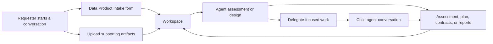

# Agentic Data Product Workflow

## Purpose

This use case supports a requester and a set of specialized agents as they create, enhance, assess, operate, or retire a data product. The browser agent provides a conversation-led workspace where request details, evidence, and generated deliverables remain available throughout the work.

The platform primitives are intentionally reusable. A data product lifecycle is the first scenario layer; other structured work requests can use the same workspaces, artifacts, forms, and delegated conversations.

## User Journey

1. A requester starts a conversation and selects an intent such as creating a data product, enhancing one, reporting an issue, or requesting retirement.
2. The requester completes the **Data Product Intake** form to capture the business need, domain, candidate source systems, and success criteria.
3. The requester uploads supporting JSON, Jupyter Notebook, or text artifacts. The application stores them in the active workspace.
4. The requester or agent references an artifact by typing `@` in the composer and selecting it from autocomplete.
5. An agent lists and reads relevant text or JSON artifacts, then produces an assessment, specification, plan, or other deliverable.
6. A user delegates a focused prompt to another configured agent. The child conversation retains the workspace scope and records its parent conversation.
7. Accepted intake forms and generated artifacts stay in the workspace for later review, handoff, or follow-up work.

## Workflow Shape



## Implemented Capabilities

### Workspace and artifact foundation

- A generic `Workspace` bounds artifacts, form instances, and child-thread relationships.
- A generic `ArtifactRepository` interface supports workspace initialization, listing, reading, writing, and resolving artifacts.
- Browser-local storage is available through IndexedDB.
- GitHub-backed storage is available through `GitHubArtifactRepository` for shared, versioned artifacts.
- GitHub storage uses a configuration-bound same-origin proxy. The browser does not directly call GitHub Enterprise, avoiding CORS restrictions.
- GitHub Enterprise API values ending in `/api` are normalized to `/api/v3`; GraphQL requests use `/api/graphql` and Contents API requests use `/api/v3`.
- Artifact paths are constrained to the configured repository root and workspace. Relative path traversal is rejected.
- GitHub writes support expected revisions for optimistic concurrency.

### Upload and artifact reference experience

- The chat composer accepts `.json`, `.ipynb`, and `.txt` attachments.
- Uploads are stored below `uploads/` in the active workspace.
- Existing artifact paths trigger a collision confirmation flow before replacement.
- Typing `@` opens artifact autocomplete over the active workspace.
- A sent upload adds readable artifact paths to the chat message.

### Agent artifact access

- `artifact_list` lets an agent discover artifacts in the active workspace.
- `artifact_read` reads text and JSON artifacts by artifact ID.
- Artifact access is bounded to the active workspace and repository.

### Markdown-defined forms

- Forms use Markdown with YAML frontmatter, matching the skill authoring approach.
- Fields support type, label, options, defaults, required validation, help text, agent instructions, and optional regular-expression validation.
- Users can save a draft or accept a form.
- Each saved form persists both structured data and rendered Markdown artifacts:
  - `forms/<form-name>.json`
  - `forms/<form-name>.md`
- The included scenario form is [proxy/forms/data-product-intake.md](../proxy/forms/data-product-intake.md). It captures the request type, product name, business need, domain, candidate sources, and success criteria.

### Agent delegation

- A user can launch a child chat with a selected configured agent and a focused prompt.
- Child thread metadata records the parent thread, selected agent, prompt, and inherited workspace ID.
- The child thread uses its selected agent when building the system prompt.

## Configuration

GitHub artifact storage is optional. Without this configuration, artifacts remain in browser-local IndexedDB.

To enable GitHub-backed storage, configure the server environment:

```sh
GITHUB_ARTIFACT_REPOSITORY=owner/repository
GITHUB_ARTIFACT_BRANCH=main
GITHUB_ARTIFACT_ROOT=browser-agent-artifacts
GITHUB_API_URL=https://github.example.com/api/v3
```

`GITHUB_API_URL` may also be supplied as `https://github.example.com/api`; the server normalizes it to `/api/v3`.

The user must configure a GitHub token in the browser agent settings. The token is sent to the same-origin artifact proxy, which forwards it only to the configured GitHub artifact endpoint. The configured repository, branch, and root remain server-controlled.

Artifacts for the initial default workspace are stored beneath:

```text
<GITHUB_ARTIFACT_ROOT>/default/
```

For GitHub Enterprise, the proxy uses:

```text
GraphQL: <host>/api/graphql
REST:    <host>/api/v3
```

## Manual Verification

1. Start the server with `npm run dev` and open `http://localhost:4222/`.
2. Open **Forms**, complete **Data Product Intake**, save a draft, reopen it, and confirm values persist.
3. Accept the form and confirm `forms/data-product-intake.json` and `forms/data-product-intake.md` are listed as artifacts.
4. Attach a JSON, Notebook, or text file, send the message, and verify it appears as an artifact below `uploads/`.
5. Type `@` in the composer, select the uploaded artifact, and send a question asking an agent to inspect it.
6. Confirm the agent can use `artifact_list` and `artifact_read` for text or JSON content.
7. Delegate a prompt to another agent and verify that a child conversation opens with the requested prompt.
8. With GitHub storage configured, confirm repository contents are written below the configured root and branch.

## Automated Verification

Use the installed Chromium build when Playwright's managed browser is unavailable:

```sh
cd /home/un807/Workspaces/dbg/STX.BROWSER_AGENT
export PLAYWRIGHT_EXECUTABLE_PATH="$HOME/.cache/ms-playwright/chromium-1194/chrome-linux/chrome"
npm run build
npm test
```

The current Playwright suite covers standalone application rendering, the lifecycle UI, settings, composer behavior, widget mode, widget injection, and Trusted Types compatibility. Artifact repository operations, upload persistence, form persistence, delegation, and GitHub Enterprise proxy behavior currently have targeted implementation probes but do not yet have committed end-to-end Playwright coverage.

## Remaining Work

The following capabilities are required for a complete production lifecycle workflow but are not implemented yet:

- Workspace creation, selection, archival, and explicit thread-to-workspace selection. The current UI uses the `default` workspace.
- A form picker when multiple forms are available. The current Forms control opens the first configured form.
- Agent-proposed form field edits with explicit user review, acceptance, or rejection.
- Structured artifact references in chat-message metadata and clickable artifact chips. Current messages contain textual references.
- Configurable upload policy per scenario or repository. Current allowed extensions are JSON, Notebook, and text files.
- Agent-specific artifact tool allowlists wired to the selected thread agent. The tool hook supports an allowlist, but the active thread's declared tools are not yet passed into it.
- Recursive GitHub artifact listing. The current GraphQL tree query lists direct entries only.
- Lifecycle-specific state, approvals, ownership, Jira integration, and durable mappings from lifecycle stages to workspace artifacts.
- End-to-end tests for browser artifacts, GitHub proxy authentication and writes, form acceptance, `@` selection, and child-agent delegation.
